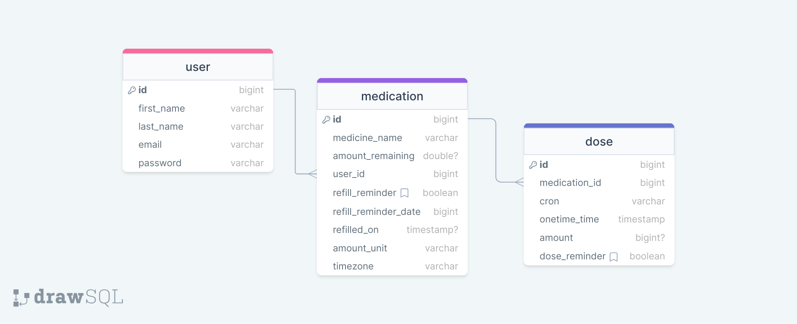

# DrugBugServer

DrugBug is a full-stack web app for tracking medications.
I made it using React, JavaScript, Node.js, Express,js, Knex, and Bootstrap. It includes a front end that allows users to add, view, and edit medications and doses to receive email and web push notifications when it is time for a dose or to order a refill. You can now also search for interactions your medications could have with food, drinks, or other medications.

### This is the back end repository. The repository for the front end can be found [here](https://github.com/stevefali/DrugBug)

The server, where all the magic happens, grabs the current data in the MySQL database that I created, schedules notifications using cron syntax and triggers them in real time in worker threads that build notifications and then trigger them using Pingram's API (Formerly 'NotificationAPI'). The server also handles interaction searches by fetching data from the US FDA API and filtering through the results to find matches for the interactor queried by the user.

## Implementation

### Tech Stack

- React
- Node
- MySQL
- Express
- Client Libraries:
  - react
  - react-router
  - axios
  - Bootstrap
- Server Libraries:
  - Bree
  - knex
  - express
  - [Pingram](https://www.pingram.io/)

## Installation and Running Instructions

To install the server (this repo) you need to:
- Make sure you have [Node.js](https://nodejs.org/en) installed on your computer.
- Run `npm i` in the command line to install the node modules.
- Make a MySQL database.
- [Create a developer account with Pingram](https://app.pingram.io/signup) if you haven't already.
- Signup to get an FDA API key [here](https://open.fda.gov/apis/authentication/)
- Create a Vapid key for push notifications. You create one using this [free Vapid key pair generator](https://progressier.com/vapid-key-generator)
- Create a JWT key. You can do this by running a command like `openssl rand -base64 32`.
- Create a file called `.env` in the root directory of the project, using the existing `.env.example` file as a template
  	- Replace the placeholder values with real ones, including the values created in the last 5 steps. (Omit the `<>`'s!)
- Run these commands:
	- `npm run migrate`
 	- `npm run seed`
    - `npm start`

### Current Database Structure Visualization

## Next Steps for DrugBug
There are several updates and new features I have in mind for DrugBug, including:
- "Caregiver Mode": Refactor to allow users to add "patients" and/or family members, etc., to their profile, rather than all medications in the account being linked to just the one user.
- Add the ability for users to add new medications by taking a picture of their medication labels, instead of having to manually type every detail.
- Add a feature that estimates how much of each medication users have left (based on the doses) and when they will need to order more.
- Send push notifications and emails directly from DrugBug's server, eliminating the need for the Pingram API.
- Add a "quick view" screen that lists all the user's medications, dosages, and allergies, that they can easily present on intake to hospitals, clinics, etc.
- Allow users to add their pharmacy information, such as contact info, hours, address, etc., and make it easy to order refills.
- Front-end revamp/remodel to make the app look and feel more professional.

